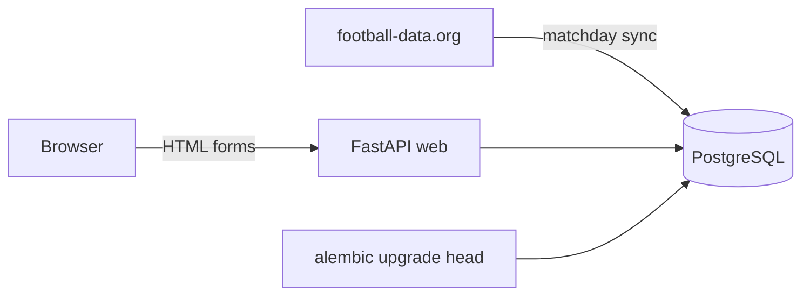

# Matchday

[](https://github.com/michaljakubowski2001/matchday/actions/workflows/ci.yml)

> **TL;DR** – A small football-predictions app for friends, used as a real workload for a complete delivery pipeline.
> - Python (FastAPI, SQLAlchemy, Alembic) on PostgreSQL; the UI is in Polish for its users.
> - Every pull request: lint, 24 tests on a real PostgreSQL built from the migrations, image build, Trivy gate and SBOM, then a smoke test of the whole stack from the built image.
> - Next stages: signed images in a registry, preview environments per pull request, GitOps promotion with canary releases and automatic rollback.

Friends join a league with an invite code, predict scores until kickoff and get points automatically when results arrive: 3 for the exact score, 1 for the right winner or draw. Fixtures come from [football-data.org](https://www.football-data.org/) (Champions League and Premier League on the free plan) through a sync command that Kubernetes will run as a CronJob.

**Status:** stage 1 of 4. The app, tests, container image and pull-request pipeline work; nothing is deployed yet.

## Roadmap

| Stage | Scope | Status |
|---|---|---|
| 1 | App, tests on PostgreSQL, hardened image, PR pipeline with vulnerability gate, SBOM and smoke test | ✅ done |
| 2 | Push to GitHub Container Registry, keyless signing with cosign, preview environment per pull request on kind with end-to-end tests | planned |
| 3 | Argo CD staging and production, promotion by pull request, canary release with automatic rollback, sync as a CronJob | planned |
| 4 | Public deployment on Azure Container Apps with Terraform and OIDC | optional |

## Architecture



- **web**: server-rendered pages (Jinja2), sessions in a signed cookie, `/healthz` and `/readyz` for probes.
- **sync**: one-shot command that upserts fixtures from a week ago to two weeks ahead. Running it twice changes nothing.
- **migrate**: one-shot Alembic job; the schema is never created by the app itself.
- **providers**: the same interface for football-data.org and a deterministic fake, so tests and local runs never call the real API.

## Design decisions

- **Points are computed, not stored.** The leaderboard is calculated from predictions and results on each request. A corrected result fixes every table immediately, with no backfill job.
- **One prediction per match per user**, shared by all the user's leagues: nobody has to type the same score three times.
- **Locked at kickoff on the server.** The form disappears in the UI, but the rule lives in the endpoint and has a test.
- **Tests use PostgreSQL, not SQLite**, and build the schema by running the migrations. A separate test runs `alembic check`, so a model change without a migration fails CI.
- **No default secret key.** The app refuses to start without `MATCHDAY_SECRET_KEY`, so a development key cannot reach production by accident.

## Security

- Passwords hashed with Argon2; login sessions in a signed, `HttpOnly`, `SameSite=Lax` cookie (`Secure` when `MATCHDAY_SECURE_COOKIES=true`).
- The redirect target after a prediction is validated against `/leagues/<id>`, so the form cannot be used as an open redirect.
- League pages return 404 to non-members.
- Image: base images pinned by digest, dependencies installed from `uv.lock`, runs as UID 10001, no pip in the runtime image.
- CI: actions pinned to commit SHAs, Trivy installed from the release with its checksum verified instead of through a third-party action, read-only `GITHUB_TOKEN`.
- **Known limits:** no rate limiting on login yet and no password reset. Both are acceptable for a private league of friends and listed for later.

## Troubleshooting log

**1. Trivy blocked the first image on four HIGH vulnerabilities**
- *Problem:* the scan reported `urllib3`, `msgpack` and `setuptools` with fixed versions available, none of which the app depends on.
- *Cause:* they are vendored inside `pip` in the official Python base image. The app runs from its own virtualenv and never uses that pip.
- *Fix:* the runtime stage uninstalls pip and the bundled `ensurepip` wheels. The scan is clean and the gate stays strict (`--exit-code 1` on fixable HIGH and CRITICAL) instead of ignoring the findings.

## How to run

```bash
docker compose up --build --wait     # database, migrations, fixture sync, web
open http://localhost:8000
```

Uses generated fixtures by default. For real matches, get a free token at football-data.org and run with `MATCHDAY_PROVIDER=football-data MATCHDAY_FOOTBALL_DATA_TOKEN=...`.

Development:

```bash
uv sync
docker compose up -d db
docker compose exec db psql -U matchday -c 'CREATE DATABASE matchday_test'
uv run pytest
uv run ruff check . && uv run ruff format --check .
```
